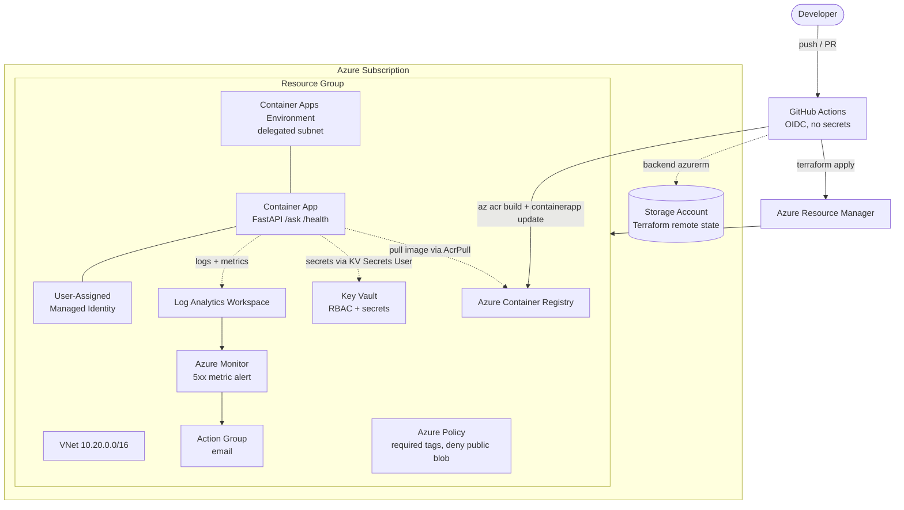

# azure-ai-service-infra

Infrastructure-as-code and CI/CD for deploying a FastAPI **LLM / RAG** service to
Azure Container Apps. The workload is managed with Terraform (`azurerm`), deployed
through GitHub Actions using **OIDC federated credentials** (no stored cloud
credentials), with remote state in Azure Storage.

The app exposes:

| Endpoint  | Method | Purpose                                             |
| --------- | ------ | --------------------------------------------------- |
| `/health` | GET    | Liveness/readiness probe target                     |
| `/ask`    | POST   | RAG-retrieve + LLM completion                       |
| `/boom`   | GET    | Returns HTTP 500 on purpose, to exercise the alert  |

The LLM provider is toggled between **Azure OpenAI** (primary) and **Groq**
(fallback). See [Provider toggle](#provider-toggle-azure-openai--groq).

---

## Architecture



<details>
<summary>ASCII version</summary>

```text
                         GitHub Actions (OIDC, no stored secrets)
                        /                |                     \
             terraform apply      az acr build           az containerapp update
                       |            |                            |
                       v            v                            v
        +----------------------------- Azure Subscription -----------------------------+
        |  Storage Account (Terraform remote state, AAD-auth, no public blob access)   |
        |                                                                             |
        |  +---------------------------- Resource Group ----------------------------+  |
        |  |  VNet 10.20.0.0/16                                                     |  |
        |  |    snet-apps (/23, delegated Microsoft.App/environments)               |  |
        |  |    snet-private-endpoints (/24)                                        |  |
        |  |                                                                        |  |
        |  |  ACR  <---- AcrPull ----  User-Assigned Managed Identity               |  |
        |  |                              ^   ^                                     |  |
        |  |  Container Apps Env          |   |  Key Vault Secrets User             |  |
        |  |    Container App  ---------- +   +--------->  Key Vault (RBAC)         |  |
        |  |      /health  /ask  /boom                                              |  |
        |  |        |                                                               |  |
        |  |  Log Analytics <-- metrics/logs                                        |  |
        |  |  Azure Monitor (5xx metric alert) --> Action Group --> email           |  |
        |  |  Azure Policy: required tags + deny public blob access                 |  |
        |  +------------------------------------------------------------------------+  |
        +-----------------------------------------------------------------------------+
```

</details>

### Security highlights

- **No long-lived cloud credentials in CI.** GitHub Actions authenticates to Azure
  with a short-lived OIDC token; the app pulls images and reads provider keys from
  Key Vault with a user-assigned managed identity.
- **Least-privilege RBAC** granted per resource, not at resource-group scope:
  - app identity → `AcrPull` on the single ACR
  - app identity → `Key Vault Secrets User` on the single vault
  - app identity → `Cognitive Services OpenAI User` on the OpenAI account (when provisioned)
  - deployer → `Key Vault Secrets Officer` on the vault (to write secrets)
- **Key Vault** uses RBAC authorization, soft delete, and optional private endpoint.
- **ACR** has the admin account disabled and public access can be disabled in favor
  of a private endpoint (`enable_private_endpoints = true`).
- **Private endpoints are opt-in.** With `enable_private_endpoints = true`, public
  access to ACR and Key Vault is disabled. The GitHub-hosted deploy workflow then
  cannot run `az acr build` or write Key Vault secrets from the public internet;
  use a self-hosted runner inside the VNet (plus an ACR build agent pool) for that
  mode.

---

## Repository layout

```text
.
├── app/                          # FastAPI LLM/RAG service
│   ├── main.py                   # routes: /health, /ask, /boom
│   ├── llm.py                    # Azure OpenAI primary + Groq fallback
│   ├── rag.py                    # dependency-free in-memory retriever
│   ├── config.py                 # env-driven settings (pydantic-settings)
│   ├── Dockerfile                # multi-stage, non-root
│   └── tests/                    # pytest suite
├── infra/
│   ├── bootstrap/                # creates the remote-state storage account
│   │   ├── bootstrap.ps1
│   │   └── bootstrap.sh
│   └── terraform/                # all infrastructure
│       ├── main.tf               # random suffix + resource group
│       ├── network.tf            # VNet, subnets, private endpoints/DNS
│       ├── registry.tf           # ACR
│       ├── identity.tf           # user-assigned identity + RBAC
│       ├── keyvault.tf           # Key Vault + secrets
│       ├── openai.tf             # optional Azure OpenAI account + deployment
│       ├── container_apps.tf     # Container Apps env + app
│       ├── monitoring.tf         # Log Analytics, action group, 5xx alert
│       ├── policy.tf             # Azure Policy definitions + assignments
│       └── policies/*.json
├── scripts/
│   ├── setup-oidc.ps1 / .sh      # create GitHub OIDC identity + RBAC
│   └── teardown.ps1 / .sh        # destroy the stack
└── .github/workflows/
    ├── app-ci.yml                # tests + docker build on app changes
    ├── terraform-plan.yml        # plan on PR (OIDC)
    └── deploy.yml                # apply + image deploy on merge to main
```

---

## Prerequisites

- Azure CLI (`az`) ≥ 2.60, authenticated (`az login`)
- Terraform ≥ 1.5
- Docker (only for local image builds; CI uses `az acr build`)
- Python 3.11 + `uv` or `pip` (for running tests locally)
- An Azure subscription where you can create resources and role assignments
  (`Contributor` + `User Access Administrator`)

---

## 1. Bootstrap remote state (once)

```powershell
# Windows PowerShell
cd infra/bootstrap
./bootstrap.ps1 -Location eastus2
```

```bash
# macOS / Linux
cd infra/bootstrap
./bootstrap.sh eastus2
```

This creates `rg-tfstate`, a hardened storage account, and the `tfstate`
container, then prints backend values. Copy them into
`infra/terraform/backend.hcl` (see `backend.hcl.example`).

---

## 2. Create the GitHub OIDC identity (once)

```powershell
./scripts/setup-oidc.ps1 -GitHubRepo <owner>/<repo> `
    -StateStorageAccountId /subscriptions/<sub>/resourceGroups/rg-tfstate/providers/Microsoft.Storage/storageAccounts/<stacct>
```

```bash
./scripts/setup-oidc.sh <owner>/<repo> /subscriptions/.../storageAccounts/<stacct>
```

It creates an app registration + service principal with two federated
credentials (`pull_request` and `refs/heads/main`) and grants:

- `Contributor` on the subscription (create/update resources)
- `User Access Administrator` on the subscription (create the role assignments
  Terraform defines)
- `Storage Blob Data Contributor` on the state storage account (AAD-auth state)

No client secret is created.

### Configure GitHub repository variables

Settings → Secrets and variables → Actions → **Variables**:

| Variable                  | Description                                  |
| ------------------------- | -------------------------------------------- |
| `AZURE_CLIENT_ID`         | App registration (client) ID from step 2     |
| `AZURE_TENANT_ID`         | Azure tenant ID                              |
| `AZURE_SUBSCRIPTION_ID`   | Azure subscription ID                        |
| `TF_STATE_RESOURCE_GROUP` | e.g. `rg-tfstate`                            |
| `TF_STATE_STORAGE_ACCOUNT`| e.g. `sttfstate123456`                       |
| `TF_STATE_CONTAINER`      | e.g. `tfstate`                               |
| `ALERT_EMAIL`             | Email that receives the 5xx alert            |

Settings → Secrets → Actions → **Secrets** (optional):

| Secret            | Description                                   |
| ----------------- | --------------------------------------------- |
| `GROQ_API_KEY`    | Groq key for the fallback provider            |

---

## 3. Deploy

- **Pull request** touching `infra/**` → `terraform-plan` runs `fmt`, `validate`,
  and `plan`, and posts the plan as a PR comment.
- **Merge to `main`** → `terraform-apply` (deploy.yml) runs `terraform apply`,
  builds and pushes the image to ACR with `az acr build`, rolls a new revision
  with `az containerapp update`, then smoke tests `/health`.

### Local deploy (alternative)

```powershell
cd infra/terraform
terraform init -backend-config=backend.hcl
terraform plan  -var="image_tag=latest"
terraform apply -var="image_tag=latest"

# Build and push the image, then roll the revision:
$acr = terraform output -raw container_registry_name
az acr build --registry $acr --image azure-ai-service:latest ./..\app
az containerapp update -n (terraform output -raw container_app_name) `
  -g (terraform output -raw resource_group_name) `
  --image "$(terraform output -raw container_registry_login_server)/azure-ai-service:latest"
```

For a bring-your-own key instead of the Terraform-provisioned Azure OpenAI:

```powershell
$env:TF_VAR_groq_api_key   = "gsk_..."
$env:TF_VAR_azure_openai_key = "..."   # optional override
terraform apply
```

---

## Provider toggle (Azure OpenAI / Groq)

The app resolves its provider at runtime (`config.py`):

1. `LLM_PROVIDER=auto` (default) prefers **Azure OpenAI** when an endpoint, key,
   and deployment are configured.
2. If Azure OpenAI is disabled or errors at request time, it **falls back to
   Groq** when `GROQ_API_KEY` is present.
3. With nothing configured it returns an echo response (useful for smoke tests).

Control it in Terraform:

```hcl
# Use the Terraform-provisioned Azure OpenAI account (default).
enable_azure_openai = true
azure_openai_model  = "gpt-4o-mini"

# Groq-only: no Azure OpenAI account is created; the service runs on Groq.
enable_azure_openai = false
enable_groq_fallback = true
```

Secrets (`azure-openai-key`, `groq-api-key`) live in Key Vault and are injected
into the container at runtime through the managed identity — never in the image
or in source.

---

## Observability & the 5xx alert

- **Log Analytics** receives container stdout/stderr and platform metrics.
- `azurerm_monitor_metric_alert.http_5xx` fires when the `Requests` metric with
  dimension `statusCodeCategory = 5xx` exceeds `alert_5xx_threshold` (default 5)
  over `PT5M`. It notifies `azurerm_monitor_action_group.main` (email).

### Fire the test alert

```powershell
$fqdn = terraform -chdir=infra/terraform output -raw container_app_fqdn
# Generate 5xx responses (the threshold is 5 within 5 minutes):
1..20 | ForEach-Object { try { Invoke-WebRequest "https://$fqdn/boom" -ErrorAction SilentlyContinue | Out-Null } catch {} }
```

```bash
FQDN=$(terraform -chdir=infra/terraform output -raw container_app_fqdn)
for i in $(seq 1 20); do curl -s -o /dev/null "https://${FQDN}/boom"; done
```

Within a few minutes the alert transitions to **Fired** in the Azure portal
(Monitor → Alerts) and an email is delivered to `ALERT_EMAIL`. Disable the test
endpoint in production with `enable_boom_endpoint = false`.

---

## Governance (Azure Policy)

Two custom policy definitions are created and assigned at the workload resource
group scope:

| Policy                              | Effect                | Purpose                                             |
| ----------------------------------- | --------------------- | --------------------------------------------------- |
| `require-tag-<prefix>`              | `deny` (or `audit`)   | Resources must carry `environment`, `project`, `owner` |
| `deny-public-blob-<prefix>`         | `deny`                | Blocks storage accounts that allow anonymous public blob access |

Set `enforce_tag_policy = false` to switch the tag policy to `audit` (recommended
while you retrofit tags). Non-taggable resource types (role assignments, subnets,
secrets, …) are exempted automatically.

---

## Cost notes

This stack is designed to be cheap to run and to scale to zero. Order of magnitude
for a light dev workload in `eastus2` (USD, subject to change — always check the
[Azure Pricing Calculator](https://azure.microsoft.com/pricing/calculator/)):

| Resource                          | Billing model                         | Rough monthly cost      |
| --------------------------------- | ------------------------------------- | ----------------------- |
| Azure Container Apps              | Consumption, scale-to-zero            | ~$0–5 (pay per vCPU-s/GB-s) |
| Container Registry (Basic)        | Fixed                                 | ~$5                     |
| Log Analytics                     | Pay per GB ingested + retention       | ~$0–5 (small volume)    |
| Key Vault (Standard)              | Per 10k operations                    | < $1                    |
| Azure Monitor alert               | Per metric alert (first ones free-ish)| < $1                    |
| VNet / subnets                    | Free (private endpoints billed hourly) | $0 (or ~$7/PE if enabled) |
| Azure OpenAI                      | Per 1k tokens                         | Usage-based             |
| Storage account (remote state)    | LRS + minimal ops                     | < $1                    |

**Notes**

- `min_replicas = 0` lets Container Apps scale to zero when idle, so the app is
  free while unused; the first request after idle has a cold start.
- `enable_private_endpoints = false` by default to avoid the per-endpoint hourly
  charge. Enable it for production-grade network isolation.
- The biggest variable cost is typically **Azure OpenAI tokens** or **log
  ingestion**. Set `log_retention_days` (default 30) and sampling as needed.
- Azure OpenAI (`S0`) has no fixed cost — you only pay for tokens.

---

## Teardown

Destroy everything Terraform created (this is the required clean-destroy path):

```bash
terraform -chdir=infra/terraform destroy -auto-approve
```

or use the helper scripts:

```powershell
./scripts/teardown.ps1
```

```bash
./scripts/teardown.sh
```

Then remove the resources that are intentionally outside the workload state
(optional, only if you are done for good):

```bash
# Remote-state storage + resource group (created by bootstrap)
az group delete --name rg-tfstate --yes --no-wait

# GitHub OIDC app registration (created by setup-oidc)
az ad app delete --id <AZURE_CLIENT_ID>
```

> The Key Vault has soft delete (7 days) and purge protection disabled, so
> `destroy` purges it immediately. If you enable `purge_protection_enabled`, the
> vault name is reserved for the retention period after destroy.

---

## Verification

Local verification (2026-10-30) is recorded in
[docs/EVIDENCE.md](docs/EVIDENCE.md), including exact tool versions and raw output.

- **Verified:** pytest (6/6), Terraform `fmt`/`init -backend=false`/`validate`,
  actionlint, ShellCheck, TFLint, secret scan, and the README/layout/variables/
  outputs/workflows completeness audit.
- **Not verified:** Docker build/container smoke (Docker unavailable), live Azure
  deployment, `/health` on the FQDN, the 5xx alert firing and email delivery, clean
  `terraform destroy`, and CI workflow runs (no Azure CLI or `gh` in the verification
  environment).

The stack has **not** been deployed or destroy-tested as part of this verification.

---

## Verify the stack (definition of done)

1. `terraform -chdir=infra/terraform destroy -auto-approve` completes without
   errors (run it against a throwaway environment to confirm).
2. `curl https://<container_app_fqdn>/health` returns
   `{"status":"ok", ...}`.
3. The 5xx test alert (`/boom` loop above) transitions to **Fired** and an email
   is delivered.

---

## Local development

```powershell
cd app
uv venv .venv
uv pip install -r requirements.txt -r requirements-dev.txt
.\.venv\Scripts\python.exe -m pytest -q
.\.venv\Scripts\python.exe -m uvicorn main:app --reload --port 8000
# then open http://127.0.0.1:8000/docs
```
